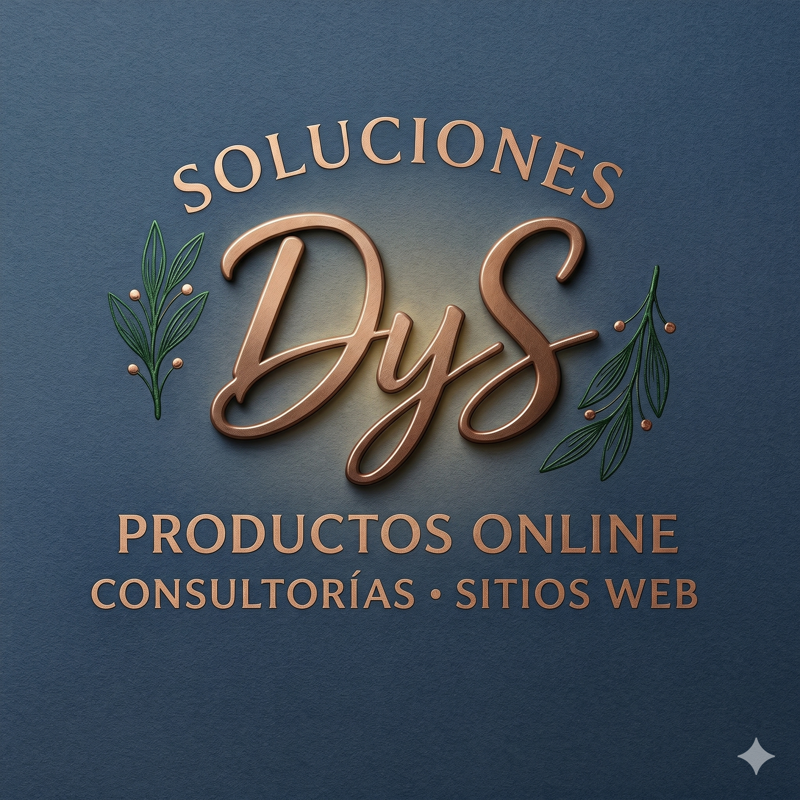

<div align="center">



# Soluciones DyS

**Sitios web a medida para pymes de Puerto Varas, Los Lagos y todo Chile.**

[](https://nextjs.org)
[](https://react.dev)
[](https://www.typescriptlang.org)
[](https://tailwindcss.com)
[](https://vercel.com)
[](LICENSE)

[Ver el sitio](https://www.solucionesdys.cl) · [Reportar un problema](https://github.com/diegocabre/solucionesdys/issues)

</div>

---

## Índice

- [¿Qué problema resuelve?](#qué-problema-resuelve)
- [Características principales](#características-principales)
- [Tecnologías](#tecnologías)
- [Requisitos previos](#requisitos-previos)
- [Instalación paso a paso](#instalación-paso-a-paso)
- [Uso](#uso)
- [Estructura del proyecto](#estructura-del-proyecto)
- [Configuración (.env)](#configuración-env)
- [Despliegue](#despliegue)
- [Roadmap](#roadmap)
- [Cómo contribuir](#cómo-contribuir)
- [Licencia](#licencia)
- [Autor](#autor)

---

## ¿Qué problema resuelve?

Muchas pymes necesitan un sitio web que de verdad les traiga clientes, pero no saben qué tipo de sitio les conviene (landing page, sitio corporativo o tienda online) ni en quién confiar para hacerlo.

Este repositorio es el sitio de **Soluciones DyS**, un estudio de diseño y desarrollo web con base en Puerto Varas. El sitio tiene un objetivo claro: **que el dueño de una pyme escriba para cotizar**, ya sea por el formulario de contacto, por WhatsApp o por correo.

Para ganarse esa confianza, además de mostrar proyectos reales, el sitio ofrece contenido útil y gratuito:

- un **blog** con guías prácticas (por ejemplo, cómo aparecer en Google Maps);
- una sección **Aprende IA**, que explica la inteligencia artificial sin tecnicismos;
- una sección **Comunidad**, con las **farmacias de turno** de la zona en tiempo real.

## Características principales

**Sitio público**

- 🏠 **Portada** con servicios, caso destacado, zona de atención, preguntas frecuentes y últimos artículos.
- 💼 **Portafolio** (`/webs` y `/webs/casos/[slug]`) con proyectos reales de clientes y sitios de partners (`/partners`).
- ✍️ **Blog en MDX** (`/blog`) con tabla de contenidos, tiempo de lectura, imágenes Open Graph generadas automáticamente y **feed RSS** (`/blog/rss.xml`). Los artículos con `draft: true` no se publican en producción.
- 🤖 **Aprende IA** (`/aprende-ia`) con un robot guía y **noticias de IA en vivo** (`/api/ia-noticias`) leídas desde fuentes oficiales: Anthropic, Claude Code, OpenAI, Google DeepMind, Google y MIT.
- 💊 **Farmacias de turno** (`/comunidad/farmacias-de-turno`) para Puerto Varas y comunas cercanas, con datos del MINSAL y caché en Redis por si el servicio oficial falla.
- 📄 Páginas de **privacidad** y **términos de servicio**.

**Formulario de contacto seguro** (`/contacto`)

- Captcha con **Cloudflare Turnstile** y campo trampa (honeypot) contra bots.
- **Límite de envíos** por IP: 5 cada 10 minutos (Upstash Redis).
- Guarda cada consulta en **Supabase** (la IP se guarda como hash, nunca en claro) y avisa por correo con **Resend**, además de enviar una respuesta automática al cliente.
- Registra de dónde llegó el visitante (página de origen y parámetros `utm_*`).

**SEO, rendimiento y privacidad**

- Datos estructurados (JSON-LD), `sitemap.xml` y `robots.txt` generados desde una configuración central.
- Cabeceras de seguridad (HSTS, `X-Frame-Options`, `Permissions-Policy`, etc.).
- **Vercel Analytics** y **Microsoft Clarity**; este último solo se carga si el visitante acepta las cookies.

## Tecnologías

| Área | Herramientas |
| --- | --- |
| Framework | [Next.js 16](https://nextjs.org) (App Router, Server Actions) + [React 19](https://react.dev) |
| Lenguaje | [TypeScript 5](https://www.typescriptlang.org) |
| Estilos | [Tailwind CSS 4](https://tailwindcss.com) |
| Animaciones e íconos | [Framer Motion](https://www.framer.com/motion/), [Lucide](https://lucide.dev) |
| Contenido | [MDX](https://mdxjs.com) con `remark-frontmatter` y `remark-gfm` |
| Base de datos | [Supabase](https://supabase.com) (PostgreSQL, vía API REST) |
| Correo | [Resend](https://resend.com) |
| Caché y rate limit | [Upstash Redis](https://upstash.com) + `@upstash/ratelimit` |
| Anti-spam | [Cloudflare Turnstile](https://www.cloudflare.com/products/turnstile/) |
| Analítica | [Vercel Analytics](https://vercel.com/analytics), [Microsoft Clarity](https://clarity.microsoft.com) |
| Calidad | ESLint 9 (`eslint-config-next`) |
| Hosting | [Vercel](https://vercel.com) |

## Requisitos previos

Antes de empezar, necesitas tener instalado:

1. **[Node.js](https://nodejs.org) 20.9 o superior** (Next.js 16 lo exige). Para comprobar tu versión:

   ```bash
   node -v
   ```

2. **npm**, que viene incluido con Node.js.
3. **[Git](https://git-scm.com)**, para clonar el repositorio.

> 💡 **Para probarlo en tu computador no necesitas ninguna cuenta externa.** Sin variables de entorno, el sitio funciona igual en modo desarrollo: el captcha se omite y el límite de envíos se guarda en memoria. Las cuentas de Supabase, Resend, Upstash y Cloudflare solo hacen falta para que el formulario funcione de verdad, o para producción.

## Instalación paso a paso

**1. Clona el repositorio y entra a la carpeta**

```bash
git clone https://github.com/diegocabre/solucionesdys.git
```

```bash
cd solucionesdys
```

**2. Instala las dependencias**

```bash
npm install
```

**3. Crea tu archivo de variables de entorno**

Copia el archivo de ejemplo con el nombre `.env.local`:

```bash
cp .env.example .env.local
```

> En Windows (PowerShell) usa `Copy-Item .env.example .env.local`.

Puedes dejar los valores vacíos por ahora. Más abajo, en [Configuración (.env)](#configuración-env), se explica cada uno.

**4. Levanta el servidor de desarrollo**

```bash
npm run dev
```

**5. Abre el sitio**

Entra a [http://localhost:3000](http://localhost:3000) en tu navegador. Los cambios que hagas en el código se verán al instante.

**6. (Opcional) Prepara la base de datos de consultas**

Si quieres guardar las consultas del formulario (se revisan en el **Table Editor** de Supabase, tabla `leads`):

1. Crea un proyecto en [Supabase](https://supabase.com/dashboard).
2. Abre **SQL Editor**, pega el contenido de [`supabase/migrations/001_leads.sql`](supabase/migrations/001_leads.sql) y ejecútalo. Si usas la CLI de Supabase, también puedes correr `supabase db push`.
3. Copia la URL del proyecto y la *service role key* en `.env.local` (`SUPABASE_URL` y `SUPABASE_SERVICE_ROLE_KEY`).

La tabla `leads` queda con seguridad a nivel de filas (RLS) activa y sin políticas públicas: solo el servidor del sitio puede leerla y escribirla.

## Uso

### Comandos disponibles

| Comando | Qué hace |
| --- | --- |
| `npm run dev` | Inicia el servidor de desarrollo en `http://localhost:3000` |
| `npm run build` | Compila el sitio para producción |
| `npm run start` | Sirve la versión compilada (ejecuta antes `npm run build`) |
| `npm run lint` | Revisa el código con ESLint |

### Ejemplo: publicar un artículo en el blog

Crea un archivo `content/blog/mi-articulo.mdx` con este encabezado:

```mdx
---
title: "Título del artículo"
description: "Resumen corto para Google y redes sociales."
date: 2026-10-12
updated: 2026-10-12
slug: mi-articulo
tags: [SEO local, pymes]
ciudad: Puerto Varas
draft: true
---

Aquí va el contenido en Markdown. Los títulos `##` y `###`
aparecen en la tabla de contenidos.
```

El `slug` debe ser igual al nombre del archivo (sin `.mdx`); si no coinciden, la compilación falla con un aviso. Con `draft: true` el artículo se ve en desarrollo pero no en producción. Cuando esté listo, quita esa línea. Aparecerá solo en `/blog`, en el sitemap y en el RSS.

### Ejemplo: cambiar los datos del negocio

Teléfono, correo, comunas atendidas y redes sociales están en un solo archivo, [`src/lib/site.ts`](src/lib/site.ts). Al editarlo, el cambio se aplica a los metadatos, el sitemap, `robots.txt` y los datos estructurados:

```ts
export const AREA_SERVED = ["Puerto Varas", "Llanquihue", "Frutillar", "Puerto Montt"] as const;
```

Del mismo modo:

- los **proyectos del portafolio** se editan en [`src/lib/casos.ts`](src/lib/casos.ts);
- los **sitios de partners** se editan en [`src/lib/partners.ts`](src/lib/partners.ts);
- las **preguntas frecuentes** se editan en [`src/lib/faq.ts`](src/lib/faq.ts).

### Ejemplo: consultar las APIs internas

```bash
curl http://localhost:3000/api/ia-noticias
```

```bash
curl http://localhost:3000/api/farmacias-turno
```

## Estructura del proyecto

```text
solucionesdys/
├── content/
│   └── blog/                  # Artículos del blog en MDX
├── public/
│   └── assets/                # Logo, imágenes y capturas de proyectos
├── src/
│   ├── app/                   # Rutas (App Router de Next.js)
│   │   ├── page.tsx           # Portada
│   │   ├── webs/              # Portafolio y casos de éxito
│   │   ├── partners/          # Sitios de partners
│   │   ├── blog/              # Listado, artículos, imagen OG y RSS
│   │   ├── aprende-ia/        # Sección educativa sobre IA
│   │   ├── comunidad/         # Farmacias de turno
│   │   ├── contacto/          # Formulario + Server Action de envío
│   │   ├── api/               # Endpoints: farmacias-turno, ia-noticias
│   │   ├── privacidad/, terminos/
│   │   ├── sitemap.ts, robots.ts
│   │   └── layout.tsx, globals.css
│   ├── components/            # Componentes de interfaz (Navbar, Footer, FAQ, etc.)
│   ├── lib/                   # Lógica y datos
│   │   ├── site.ts            # Configuración central del negocio
│   │   ├── casos.ts, partners.ts, faq.ts
│   │   ├── blog.ts            # Lectura de artículos y frontmatter
│   │   ├── farmacias*.ts      # Consulta al MINSAL + caché en Redis
│   │   ├── ia-noticias.ts     # Lectura de noticias de IA (RSS/Atom)
│   │   ├── rate-limit.ts, redis.ts, turnstile.ts
│   │   └── supabase/server.ts # Cliente mínimo de Supabase
│   └── mdx-components.tsx
├── supabase/
│   └── migrations/            # SQL de la tabla `leads`
├── .env.example               # Plantilla de variables de entorno
├── next.config.ts             # MDX, redirecciones y cabeceras de seguridad
├── PRODUCT.md                 # Contexto de producto, público y tono de marca
└── package.json
```

## Configuración (.env)

Todas las variables van en `.env.local`, que **nunca** se sube al repositorio (ya está en `.gitignore`). Usa [`.env.example`](.env.example) como base.

| Variable | ¿Obligatoria? | Para qué sirve |
| --- | --- | --- |
| `NEXT_PUBLIC_SITE_URL` | Recomendada | URL pública del sitio. Por defecto: `https://www.solucionesdys.cl` |
| `RESEND_API_KEY` | En producción | Envía el aviso de nueva consulta y la respuesta automática |
| `KV_REST_API_URL` | En producción | URL REST de Upstash Redis (también sirve `UPSTASH_REDIS_REST_URL`) |
| `KV_REST_API_TOKEN` | En producción | Token REST de Upstash Redis (también sirve `UPSTASH_REDIS_REST_TOKEN`) |
| `NEXT_PUBLIC_TURNSTILE_SITE_KEY` | En producción | Llave pública del captcha de Cloudflare Turnstile |
| `TURNSTILE_SECRET_KEY` | En producción | Llave secreta de Turnstile (solo servidor) |
| `SUPABASE_URL` | Para guardar consultas | URL del proyecto de Supabase |
| `SUPABASE_SERVICE_ROLE_KEY` | Para guardar consultas | Llave *service role* (solo servidor; **nunca** con prefijo `NEXT_PUBLIC_`) |
| `LEAD_IP_HASH_SALT` | Recomendada | Sal para guardar la IP como hash. Genérala con `openssl rand -hex 32` |
| `NEXT_PUBLIC_CLARITY_PROJECT_ID` | Opcional | ID de Microsoft Clarity. Si falta, Clarity no se carga |

`.env.example` también trae `KV_REST_API_READ_ONLY_TOKEN`, `KV_URL` y `REDIS_URL`, que agrega la integración de Upstash en Vercel. El código no las usa directamente.

**Qué pasa si falta alguna variable:**

- **En desarrollo**, el sitio sigue funcionando. Sin Turnstile se omite el captcha, sin Upstash el límite de envíos se guarda en memoria y sin Supabase la consulta solo se envía por correo.
- **En producción**, por seguridad, el formulario **rechaza los envíos** si faltan Turnstile o Upstash.

> 🧪 Para probar el captcha en local, Cloudflare publica [llaves de prueba](https://developers.cloudflare.com/turnstile/troubleshooting/testing/) que siempre aprueban.

## Despliegue

El proyecto está pensado para [Vercel](https://vercel.com):

1. Importa el repositorio en Vercel.
2. Agrega las variables de entorno de la tabla anterior en **Settings → Environment Variables**.
3. Despliega. Vercel detecta Next.js y ejecuta `npm run build` automáticamente.

> El remitente de los correos es `formulario@solucionesdys.cl`, así que el dominio debe estar verificado en Resend.

## Roadmap

Pendientes que ya aparecen en el código:

- [ ] Completar los casos de éxito con datos reales: problema inicial, métricas antes y después (visitas, consultas por WhatsApp, posición en Google, PageSpeed) y testimonios con autorización (`src/lib/casos.ts`).
- [ ] Revisar los términos de servicio con un abogado (`src/app/terminos/page.tsx`).
- [ ] Agregar una `Content-Security-Policy` que permita a Cloudflare Turnstile (`next.config.ts`).
- [ ] Publicar más guías en el blog (hoy hay 2).
- [ ] Programar la limpieza automática de consultas con más de 24 meses, con `pg_cron` (instrucciones en la migración SQL).
- [ ] Agregar `NEXT_PUBLIC_CLARITY_PROJECT_ID` a `.env.example`.

[PENDIENTE: ¿hay otras funciones planificadas que quieras incluir?]

## Cómo contribuir

¡Las mejoras son bienvenidas! Para proponer un cambio:

1. Haz un *fork* del repositorio.
2. Crea una rama para tu cambio:

   ```bash
   git checkout -b feat/mi-mejora
   ```

3. Haz tus cambios y revisa que todo compile y pase el linter:

   ```bash
   npm run lint
   ```

   ```bash
   npm run build
   ```

4. Haz un commit con un mensaje claro. El proyecto usa prefijos tipo [Conventional Commits](https://www.conventionalcommits.org/es/): `feat:`, `fix:`, `refactor:`.
5. Sube tu rama y abre un *Pull Request* explicando qué cambiaste y por qué.

**Antes de editar textos, lee [`PRODUCT.md`](PRODUCT.md).** Ahí están el público objetivo, el tono de marca ("nosotros") y algunas reglas importantes:

- No inventar testimonios, cifras ni reseñas.
- No publicar precios sin confirmarlos.
- No cambiar rutas ni títulos sin revisar el impacto en el SEO.

## Licencia

Este proyecto se distribuye bajo la licencia **MIT**. Consulta el archivo [`LICENSE`](LICENSE) para ver el texto completo.

La licencia cubre el código. El nombre y el logo de Soluciones DyS, los textos del sitio y las capturas de proyectos de clientes no forman parte de ella.

## Autor

Desarrollado por **Diego Cabre** ([@diegocabre](https://github.com/diegocabre)) para **Soluciones DyS SpA**: diseño y desarrollo web a medida en Puerto Varas, Chile.

- 🌐 [www.solucionesdys.cl](https://www.solucionesdys.cl)
- ✉️ [contacto@solucionesdys.cl](mailto:contacto@solucionesdys.cl)
- 💬 [WhatsApp +56 9 4763 7541](https://wa.me/56947637541)
- 📷 [@solucionesdys.cl](https://www.instagram.com/solucionesdys.cl/)